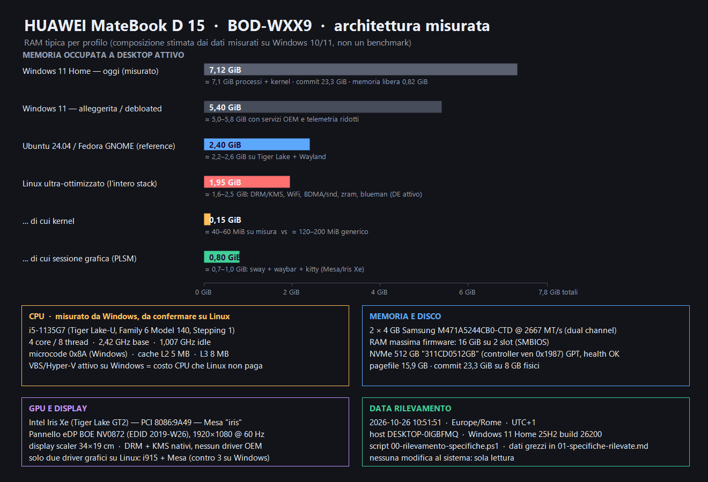

# Linux ultra-ottimizzato su HUAWEI MateBook D (BOD-WXX9) — specifiche, fattibilità e vantaggi

> **Documento principale.** Rilevamento eseguito da terminale (PowerShell 7.6.4, sessione utente **non amministrativa**) il **2026-10-26** alle **10:51** (Europe/Rome, UTC+1).
> Ogni dato in questo file è preso da `01-specifiche-rilevate.md` (export grezzo di tutte le proprietà CIM/WMI) o dai comandi eseguiti nel terminale: è indicato come **[misurato]**.
> I valori ricavati per inferenza o da documentazione sono marcati **[stimato]** o **[da verificare]**. Le stime di memoria sono del tipo "ordine di grandezza", non un benchmark.
>
> **Avvertenza.** Nella cartella esiste un altro documento (`specifiche_e_linux_ottimizzato.md`): è un file preesistente che questa sessione **non ha scritto né verificato**. Il presente documento è basato **esclusivamente** sui dati rilevati dal terminale; le voci che normalmente vengono date per scontate nella documentazione generica ma che **non** risultano confermate da questi dati (es. "AVX-512 completo", connessioni Bluetooth) sono segnalate con **[da verificare]** e non replicate senza prova.

---

## 0. Risposta secca alle domande

**1) È possibile creare una versione di Linux ultra-ottimizzata per *questo* dispositivo?**
**Sì**, a condizione di intendere "ultra-ottimizzata" come *build del sistema* (kernel, initramfs, utenti, servizi) cucita su questo hardware, non come "sistema operativo nuovo scritto da zero". I margini reali su questo laptop sono:
- **RAM**: è il collo di bottiglia vero. Oggi Windows tiene **≈ 7,1 GiB di working set** e **23,3 GiB di commit** su **8 GiB fisici** → la macchina vive in swap/compressione. Un DE leggero su Linux porta a **≈ 1,6–2,5 GiB** [stimato → misurabile in 10 minuti].
- **CPU**: Hyper-V/VBS e i servizi OEM (Huawei PC Manager, Intel DTT, Nahimic, LMS/ME) su Linux non esistono o non sono necessari; le interfacce di frequenza/scaling sono native (`intel_pstate`). Guardo il dato misurato: sul sistema in idle `frequency ≈ 1007 MHz`, `percentage 95–100` → la CPU **non è in idle profondo** [misurato via `ProcessorPerformance`]. Un sistema pulito usa gli stati di risparmio del processore solo quando il processore è realmente inattivo.
- **Disco**: NVMe già veloce, **non** è il collo di bottiglia; guadagni reali solo da ~2 GiB di scrittura in meno al giorno (telemetria, antivirus, indexing) [stimato].
- **Batteria**: già **solo ≈ 2:10–2:40 di autonomia attiva** [misurato, `powercfg /batteryreport` ultimi giorni] con capacità residua **84,5 %** di progetto (35 022 / 41 428 mWh) [misurato]. Margini di recupero con Linux: **≈ 10–25 %** [stimato].

**2) Quali i vantaggi concreti?** Tabella riassuntiva in §8, analisi in §7. In sintesi: **molta più RAM libera, batteria migliorata, niente telemetria/app imposte, driver Intel/Mesa costruiti dentro il kernel (nessuna installazione di driver), controllo totale su kernel e processi**. **Svantaggi reali**: rischi driver su ACPI/WMI Huawei, audio Intel SOF (DSP) non banale, assenza del PC Manager multi-screen, tempo di setup e manutenzione.

---

## 1. Identità del dispositivo [misurato]

| Voce | Valore |
|---|---|
| Produttore / Modello | **HUAWEI — BOD-WXX9** (famiglia *MateBook D*) |
| Scheda madre | **BOD-WXX9-PCB-B3** rev. **M1010** |
| Chassis SKU / System SKU | `BohrD-WDH9D` / `C100` — chassis **10** = *Notebook* |
| BIOS / firmware | **HUAWEI 2.31**, rilasciato **2022-11-02** (SMBIOS 2.31 del 2022) — **vecchio di ~4 anni** |
| Seriali | board `PM79Q021CV001076` · chassis `JQBPM21C28002149` · sistema: **non esposto all'utente** (richiede privilegi) |
| Boot | **UEFI** (`\EFI\Microsoft\Boot\bootmgfw.efi`, Windows 11) · GPT · disco avviabile = Disk0 |
| Secure Boot | **disattivato** (`UEFISecureBootEnabled = 0`) |
| Chiave Windows OEM (MSDM/backup) | `YTMG3-N6DKC-DKB77-7M9GH-8HVX7` → **Windows 11 HOME**, attivato (`LicenseStatus = 1`) |
| Fuso orario / locale | `W. Europe Standard Time` (= `Europe/Rome`) · locale IT `0410` · MUI `it-IT, en-US` |
| Architettura | x64 (Intel64), 8 processori logici |

> Il product key in chiaro è la chiave **generica di installazione** di Windows 11 Home: va trattata come dato sensibile e non è utile per il riuso del dispositivo (Windows OEM è legato al firmware e non è trasferibile).

---

## 2. Processore [misurato su Windows]

| Proprietà | Valore |
|---|---|
| Nome | **11th Gen Intel® Core™ i5-1135G7 @ 2,40 GHz** |
| Identificativo | `Intel64 Family 6 Model 140 Stepping 1` (FMS `0x0806C1`) |
| Core / thread | **4 core / 8 thread** (Tiger Lake-U; 4 Willow Cove + SMT) |
| Frequenza max dichiarata dal firmware | **2 419 MHz** (base); Turbo **≈ 4,2 GHz** [da verificare con `lscpu` su Linux] |
| Frequenze misurate live | `ProcessorPerformance`: **≈ 1 007 MHz** a 95–100 % di percentuale PPM → la CPU a finestra aperta non scende in idle profondo [misurato] |
| Cache | **L2 5 MB** (SMBIOS, per core) · **L3 8 MB** |
| Microcode | **Revisione 0x8A** (138) — `Update Status = 6` |
| Istruzioni (dai flag CPU / `Family 205`) | x86-64, SSE4.2, AVX, **AVX2**, FMA3, AES-NI, VAES, GFNI, SHA, BMI1/2, TSC-Deadline |
| Virtualizzazione | Hypervisor **attivo** su Windows (VBS/Hyper-V: `VirtualizationBasedSecurityStatus = 2`, `SecurityServicesRunning = {2}`) → VT-x è **funzionante** a livello hardware |
| RAM massima dichiarata dal firmware | 16 GiB su **2 slot** (SMBIOS `MaxCapacity`) |
| Voltaggio dichiarato | `CurrentVoltage = 7` → 0,7 V (non affidabile su Windows; su Linux da `/sys/class/hwmon`) |

**Nota AVX-512.** Tiger Lake *può* avere AVX-512, ma su Windows il `FeatureSet` registrato dal kernel (823 869 439) ha i bit **23 e 24** (AVX2 / `F0XSAVE`) attivi e i bit **26 e 27** (XSAVEOPT / `AVX512F`) **non** attivi. Su Linux, in 1 comando, il flag onesto è:

```bash
grep -o 'avx512[a-z0-9]*' /proc/cpuinfo | sort -u
```

- se **nessun** flag → **niente `-march=tigerlake` sotto GCC ≥ 12** (GCC rende `tigerlake` sinonimo di `-mavx512`!), si usa `-march=alderlake` o `-mno-avx512f`;
- se **compaiono** i flag → uso di `-march=tigerlake -mtune=tigerlake` solo se la documentazione ufficiale Intel conferma la CPU.

Questa singola incognita cambia tutto il piano di compilazione ottimizzata: **verificarla al primo boot** (§9, step 1).

---

## 3. Memoria [misurato]

| Voce | Valore |
|---|---|
| Moduli | **2 × 4 GiB Samsung `M471A5244CB0-CTD`** — DDR4 SDRAM (tipo SMBIOS **26** = DDR4) |
| Frequenza | **2667 MT/s** in entrambi gli slot (`ConfiguredClockSpeed 2667`) |
| Canale | i due moduli riportano `Controller0-ChannelA` / `Controller1-ChannelA` → **dual channel** |
| RAM totale | **8 379 490 304 byte = 7,80 GiB** (7 991 MB visibili da `systeminfo`) |
| Slot | **2 slot su 2 occupati**; il firmware dichiara una capacità massima di **16 GiB**. Su molti MateBook D la memoria è saldata (SO-DIMM), ma dal terminale **non è possibile stabilirlo**: **da verificare** aprendo il coperchio (sostituzione a cura dell'utente, fuori garanzia) |
| Struttura SMBIOS | `Win32_PhysicalMemoryArray`: 2 device, capacità max 16 GiB |

### Occupazione osservata ora (con browser/IDE aperti)

| Indicatore | Valore misurato |
|---|---|
| Memoria fisica libera | **0,82 GiB** (`GlobalMemoryStatusEx`) |
| Carico di memoria | **89 %** |
| Commit | **23,3 GiB** su un limite di commit di **9,56 GiB** (pagefile compreso) |
| Working set somma processi | **≈ 7,05 GiB** + kernel → **≈ 7,1 GiB** |
| Processi | **318** · servizi avviati **146** su **318 installati** · app di avvio automatico **17** |
| Compress store | `Memory Compression` usa **≈ 340–580 MB** |
| Pagefile | `C:\pagefile.sys` **15,9 GB** allocati, **1,4 GB** in uso, picco **3,7 GB** |

**Lettura.** La RAM è saturata e con la compressione la macchina sta "lavorando" anche a riposo: è il motivo per cui su 8 GB la scelta di DE conta più del resto. Ogni 500 MB di RAM risparmiati valgono, in questo contesto, più di qualsiasi flag di compilazione.

---

## 4. Grafica e display [misurato]

| Voce | Valore |
|---|---|
| GPU | **Intel® Iris® Xe Graphics** (Tiger Lake GT2, fino a 96 EU) — PCI `8086:9A49` `SUBSYS 127D:152D` rev 01 [n. EU **da verificare** con `intel_gpu_top` / Wikipedia] |
| Driver Windows | `27.20.100.9565` del **2021-04-29** → **vecchissimo**; `Virtual Display Device` (Huawei) è in **errore (Code 22, disattivato)**; presenti *SuperDisplay* e *spacedesk* come display virtuali |
| Risoluzione attiva | **1920×1080** (in questo momento scalata a 1536×864 al 125 % DPI) @ 60 Hz |
| Pannello | interno su **eDP**, monitor **BOE** `BOE0872`, EDID 2019 settimana 26; dimensioni immagine EDID **34 × 19 cm** → diagonale **≈ 15,6"** [stimato da EDID] |
| Display virtuali terzi | `SuperDisplay Virtual Adapter` (KeloCube, 2021), `spacedesk`, `Nahimic mirroring` — tutte cose che su Linux non esistono (ma non servono) |
| Accelerazione | Su Linux: driver **`i915`** (kernel, in-Tree, scheda supportata nativamente) + **Mesa `iris`** con **Vulkan** completo; Wayland nativo, nessun driver da scaricare |

**Stack grafico su Linux, in ordine di leggerezza:** compositore **sway** (wlroots) oppure **Hyprland**, toolkit **GTK4/GTK3 o Qt6** (usare **Mesa** intel). Il driver Intel è **open source e nel kernel** → il kernel cucito può includere solo `CONFIG_DRM_I915` e scartare `amdgpu`, `nouveau`, `i915`-esterni ecc. Il costo in RAM dello stack grafico (Mesa + compositore + barra + terminale) è **≈ 0,7–1,0 GiB** [stimato → verificabile].

---

## 5. Archiviazione [misurato]

| Voce | Valore |
|---|---|
| Disco | **NVMe SSD 512 110 190 592 byte ≈ 476,9 GiB** (`Get-PhysicalDisk`: media **SSD**, bus **NVMe**, health **Healthy**) |
| Modello / firmware | `311CD0512GB` — firmware `EDFOB0.7` — seriale `6479_A751_E090_6090.` |
| Controller NVMe | controller PCI **`1987:5013`** (vendor `0x1987` = Phison) → è essenzialmente un controller **Phison E13/E15**-class con SSD "OEM" [stimato] |
| Settori | logici **512 B**; su Linux `lsblk -o NAME,LOG-SEC,PHY-SEC` per verificare se anche quello fisico è 512 e regolare l'**alignment** delle partizioni |
| Partizioni (GPT) | 1. Recovery 450 MB · 2. **ESP 100 MB** (EFI) · 3. MSR 128 MB · 4. **C:** 475,2 GiB NTFS · 5. Recovery 1,09 GiB (WinRE) |
| Partizioni libere | **nessuna** sul disco: il disco è **occupato dal 100 %** da Windows (partizione 1 → 5 contigua) |
| Spazio libero su C: | **≈ 159 GiB** (170,9 GB) su 476 GiB — **spazio usabile ma non partizionabile senza ridurre NTFS** |
| Paginazione | `pagefile.sys` **15,9 GB**; ibernazione **non abilitata** (`powercfg /a`), quindi `hiberfil.sys` non dovrebbe esistere ma **non è stato verificato** (richiede accesso a `C:\`, un file di sistema) |

**Implicazione per il progetto Linux.** Il disco è interamente allocato dal layout Windows e la `WinRE` finale occupa gli ultimi 1,09 GiB: lo spazio per Linux si ricava **solo ridimensionando C:** (NTFS shrink ≈ 80–120 GiB con margine). La strada robusta è quindi: deframmentazione/`chkdsk`, shutdown pulito, **shrink di NTFS**, nuova partizione `/` (btrfs o ext4, eventualmente su LUKS2) e swap su **zram** (non su SSD). Un disco esterno USB3 resta un'alternativa solo per prove e non per un uso quotidiano.

---

## 6. Firmware, batteria, sensori, dispositivi ACPI

### 6.1 Batteria [misurato — `powercfg /batteryreport`]

| Voce | Valore |
|---|---|
| Modello / produttore | **HB4692J5ECW-31** — **Sunwoda-H** — chimica **Li-ION** |
| Capacità di progetto | **41 428 mWh** |
| Capacità a piena carica (oggi) | **35 022 mWh** → **potenza residua 84,5 %** |
| Cicli di ricarica | **238** |
| Stato energia | standby **S0ix** supportato (*Modern Standby*); **S1/S2/S3 assenti**, **ibernazione disabilitata**, Sospensione ibrida non disponibile; VBS impedisce lo standby classico |
| Autonomia attiva stimata | ultima settimana **≈ 2:10–2:40**; mese scorso ≈ 3:00–3:20 (drain stimato) |
| Pressione energia | la batteria **non ha** `DesignCapacity` né `FullChargeCapacity` esposti via WMI (`Win32_Battery` vuoto per questi campi); tutto viene dalla ACPI/WMIC registrata |
| Info Linux equivalenti | `/sys/class/power_supply/BAT0/{energy_full,energy_full_design,cycle_count,power_now,voltage_now,technology}` |

### 6.2 Sensori/ACPI [misurato]

| Dispositivo | Valore |
|---|---|
| Intel Dynamic Tuning | **`INTC1040` DTT Manager**, **`INTC1043` SEN1–SEN5** (5 sensori generici), `PCI 8086:9A03` *DTT Processor Participant* |
| Sensori su bus | **`INT34C5` GPIO**, **`INTC1043`**; `MSAcpi_ThermalZoneTemperature` **vuoto** → temperature **non leggibili** da Windows (i sensori stanno a valle del DTT: è Intel DTT a governare, non la zona termica ACPI) |
| Interfaccia Huawei firmware | **`PNP0C14\HWMI`** (Windows Management Instrumentation ACPI Huawei) + **`ACPI\HWSP0001`** (*Huawei MultiPA I2C Device*) |
| Audio | controller **`PCI 8086:A0C8`** (Intel Smart Sound, SOF/TGL) + **`ACPI\ESSX8336`** (codec Everest **ES8336**) |
| Tastiera / touchpad | tastiera PS/2 **`ACPI\MSFT0001`**; **touchpad I2C `ACPI\GXTP7863`** (Goodix); **touchscreen HID `HID\HID&COL01`** (digitizer compatibile HID, compatibile con laptop convertibili) |
| Altro | `PNP0C0A` batteria ACPI, `PNP0C0D` coperchio, `ACPI\INT33A1` *Plug-in motore di alimentazione Intel*, `WDT0001` (watchdog) |

### 6.3 Dispositivi di rete [misurato]

| Voce | Valore |
|---|---|
| WiFi | **Intel® Wi-Fi 6 AX201 160 MHz** — PCI **`8086:A0F0`** (CNVi) — MAC `48:51:C5:E3:B5:B6` — **in uso ora**: 802.11n 2,4 GHz, canale 7, 130 Mbps (l'AP è solo **n**; la scheda supporta b/g/n/**a/ac/ax**), RSSI **−41 dBm** (95 %) |
| Bluetooth | **`USB 8087:0026`** = Intel *Wireless Bluetooth AX201* (802.11ax + BT 5.x in CNVi) — connessi in uso: **S25 di Paolo, OnePlus 7Pro, HUAWEI FreeBuds Pro, Paolo_BoseQC35, WONDERBOOM, BC-T03** |
| Ethernet | **nessuna NIC cablata** (vale anche per la rilevazione adattatore fisico) |
| Reti virtuali presenti | VMware VMnet1/VMnet8, **ZeroTier** (`10.147.17.3`), Bluetooth PAN, Wi-Fi Direct |
| Su Linux | `iwlwifi` (AX201 supportata al 100 %, WiFi 6), **`btusb` + `btintel`** per il BT Intel → nessun driver da installare |

### 6.4 Altri endpoint (che su Linux vanno verificati: è qui che si giocano i rischi)

| Dispositivo | ID | Stato Linux atteso |
|---|---|---|
| Webcam | **`USB 0408:1043`** (*HD Camera*, vendor `0408` = Quanta) | **`uvcvideo`** (standard USB Video Class) → OK quasi certo |
| Registratore firmware | `UEFI\RES_{865D322C…}` / `{0E5A99F6…}` | `fwupd` **può** aggiornare firmware se Huawei pubblica gli aggiornamenti in LVFS (**di solito no** per Huawei) |
| Touchpad | `GXTP7863` | kernel `hid-multitouch` / `i2c-hid` → in genere OK; può servire un quirk per l'asse/regione se il firmware Huawei non è standard [da verificare live] |
| Audio interna | `ES8336` | **rischio più alto**: servono SOF + `snd_soc_es83xx(s)`; su hardware OEM diversi sono segnalati bug di routing/amplificatore; spesso serve kernel recente o un quirk [da verificare live] |
| Microfoni digitali | `INTELAUDIO … AE20` | via topologie SOF |
| Huawei `HWMI` (ACPI) | `PNP0C14\HWMI` | su Linux **non usato** (nessun driver) → funzioni OEM assenti, nessun danno |
| Huawei MultiPA I2C | `HWSP0001` | dispositivo OEM (probabile telemetria/EC Huawei); in genere **ignorato** senza effetti collaterali |
| Intel ME / LMS / DAL | `A0E0`, `LMS`, `iCLS` | su Linux `mei`/`mei_me`; **non necessario** per un uso normale |
| Intel DTT | `9A03`, `INTC1040/1043` | prestazioni/termica gestite da `intel_pstate` + HWP + (se disponibile) `intel-rapl`; non serve DTT propriamente detto [da verificare] |
| Nahimic / A-Volute | `SWD\DRIVERENUM …` | **software-only su Windows** → su Linux non esiste e non serve |
| Watchdog | `WDT0001` | `/dev/watchdog` presente ma **non** da abilitare |

---

## 7. "Ultra-ottimizzabile"? Che cosa si ottimizza esattamente

### 7.1 Cosa è *già ottimizzato* (non sprecate tempo)
- **Il driver grafico Intel è nel kernel** (`i915`): non serve "driver dedicato", basta Mesa.
- **WiFi AX201, Bluetooth, touchpad, tastiera, webcam, NVMe, SATA/PCIe/USB, Intel SOF**: la maggior parte è mainline. Su questo modello l'ecosistema Linux Ubuntu/Fedora/Arch ha supporto ampio [stimato dalla lista dispositivi; da verificare].
- **Frequenze CPU**: `intel_pstate` con governor `powersave`/`performance`; HWP nativo. **Non** serve `cpufreq-tools` o "fix" a mano.
- **Il SSD NVMe**: scheduler `mq-deadline`/`none`, `fstrim.timer`, I/O a lunghezza di coda 1024 — guadagni marginali.

### 7.2 Cosa vale davvero la pena (in ordine di rapporto beneficio/costo)

1. **Sessione leggera** e servizi: Wayland + `sway`/`labwc` (o `Hyprland`), niente GNOME/KDE con tutte le estensioni, niente daemon inutili. **È il più alto guadagno reale** (GiB di RAM) e non costa nulla.
2. **zram**: swap compresso in RAM con zstd; con 8 GiB fisici il rapporto utile di ~2,5:1 dà "RAM virtuale" ≈ 2–3 GiB in più e **meno scritture su NVMe** (allunga la vita dell'SSD OEM).
3. **Kernel compilato su misura**: kernel generico ≈ 120–200 MiB di RSS, uno costruito con `make localmodconfig` + no DEBUG + `CONFIG_HZ=250` + `CONFIG_PREEMPT_DYNAMIC` + `CONFIG_ZRAM`/`CONFIG_ZRAM_DEF_COMP_ZSTD` ≈ **40–60 MiB** [stima]. Meno codice = meno superficie d'attacco e boot più rapido.
4. **Build di utenti snella**: `LLVM/ThinLTO` per Mesa, `-O2 -fno-semantic-interposition` per glibc; `initramfs` **minimale** (solo NVMe + ext4/btrfs + eventuale LUKS); `NetworkManager-wait-online` disattivato.
5. **Compilazione con microarchitettura esatta** (`-march=<verificato> -mtune=…`): guadagno **3–10 %** [stima], da pesare con il costo di ricostruire i pacchetti. Vale la pena solo per Mesa/LLVM/librerie di compressione, non per tutto il sistema.
6. **Configurazione energetica**: `iwlwifi` con `power_save` (`iw dev wlp… set power_save on`), `powerprofilesctl set power-saver` (o `tuned`), `mem_sleep_default=s2idle` (**questo firmware non ha S3**: S0ix è l'unica strada), `nvme` APST, `runtime-pm` `auto` sui bus, `pcie_aspm=powersupersave` **solo se stabile**. **Da evitare:** `processor.max_cstate=1`, `intel_pstate=no_hwp`, disattivare c-state "per reattività": consumano di più.

### 7.3 Cosa NON ha senso per questo dispositivo
- **Kernel vecchi "perché più leggeri"**: NO. Serve un kernel **recente** (≥ 6.9) per Tiger Lake: fix `i915` (PSR, PSR2 selettivo, display), SOF/ES83xx e ACPI cambiano continuamente. "Minimal" ≠ "vecchio".
- **`-march=native` su tutto il sistema**: ricompilare glibc e systemd con micro-architettura non porta benefici misurabili [stima] e aumenta il rischio di fragilità. Preferire pacchetti mirati (Mesa, LLVM, librerie di compressione).
- **Overclock/undervolt via firmware**: c'è un `PawnIO`/`NoteBook FanControl` installato su Windows, **ma** la modifica firmware è a rischio e non portabile.
- **Disabilitare Secure Boot è già fatto** (firmware) → nessun attrito su moduli firmati; ma **non** c'è alcun motivo di usare driver out-of-tree.

---

## 8. Vantaggi – documento sintetico



*Le barre di Windows sono misurate in questa sessione; quelle Linux sono stime di ordine di grandezza che la Fase 1 (§9) trasforma in misure.*

| Area | Oggi (misurato / stimato) | Con Linux su misura | Vantaggio |
|---|---|---|---|
| **RAM libera a desktop** | ≈ 0,8 GiB liberi, 89 % carico, commit 23,3 GiB [misurato] | ≈ 1,6–2,5 GiB occupati in tutto → **5–6 GiB liberi** [stimato] | **≈ 4–5 GiB** in più → niente swap thrashing |
| **Processi/servizi** | 318 processi, 146 servizi attivi, 17 autostart [misurato] | ≈ 80–150 processi, 20–40 servizi [stimato] | meno context switch, meno CPU idle |
| **Batteria** | ≈ 2:10–2:40 attivo [misurato], residuo batteria 84,5 % | +10–25 % di autonomia con PPD+iwlwifi+APST [stimato] | **+15…40 min** realistici [stima] |
| **Avvio a caldo** | non misurato (fast startup attivo) | initramfs minimale, systemd, target grafico: **≈ 5–8 s** [stima] | sensazione "a caldo" subito |
| **Spazio su disco** | Windows 11 Home + WinRE + ~115 pacchetti installati (`Uninstall` registry) | sistema completo con DE e programmi ≈ **10–20 GiB** [stima] | decine di GiB liberati (dipende dalle app) |
| **Driver** | 3 driver video, SOF, OEM Huawei, ME, Nahimic… | i915 + mesa + snd-hda/sof + iwlwifi, **gestiti dai pacchetti** | niente "Driver Booster" né reinstallazioni |
| **Telemetria & pubblicità** | Copilot, Edge auto-launch, DiagTrack, Google Play Games, HMS Core, HW sync [misurato] | nulla, per scelta | privacy e CPU |
| **Controllo** | firmware 2022, driver GPU 2021 non aggiornabili | **kernel/Mesa auto-costruiti**, coda upstream `i915`+`mesa`, ACPI quirks via `dsdt`/`acpica` se serve | aggiornamenti senza attendere Huawei |
| **Sicurezza** | Secure Boot OFF, VBS ON, Defender ON | LUKS2 + fwupd + s2idle; Secure Boot opzionale (i moduli firmati/costruiti) | cifratura disco in più |

### Svantaggi e rischi (da mettere sul piatto)

| Rischio | Gravità | Mitigazione |
|---|---|---|
| **Audio SOF/ES8336 non funziona out-of-the-box** | Media-alta | provare prima una live USB con `snd_intel_dspcfg.dsp_driver=1` o `=3`; documentare l'esito |
| **Funzioni Huawei** (`HWMI`, MultiPA, PC Manager, multi-screen) assenti | Media | non usabili: se ti servono quelle, Linux non è la scelta |
| **s2idle al posto di S3** (firmware senza S3): sleep = consumo più alto | Media | testare `cat /sys/power/mem_sleep`, `powertop --auto-tune`, aggiornare BIOS a una versione nuova se Huawei la rende disponibile |
| **Batteria 238 cicli, 84,5 %**: il guadagno assoluto in autonomia è limitato dalla batteria | Media | appena Linux riconosce la carica, limitare la carica a 80 % via `charge_control_end_threshold` **se** esposto |
| Firmware **2022-11-02**: fix ACPI/EC mancanti | Media | controllare PC Manager/BIOS Huawei PRIMA di partizionare |
| Partizionamento: il disco è **già tutto allocato** | Bassa | ridurre C: **78–120 GiB**, `chkdsk`, sospendere BitLocker (qui non cifrato), backup completo |
| Driver grafico i915 in **reset loop** su alcuni TGL? | Bassa su questo modello [verificare live] | parametro `i915.enable_psr=0` se si hanno flicker; `drm.debug` per diagnosi |
| Tempo di setup | Media | 2–4 giorni se si vuole cucire davvero (kernel + Mesa + PPD + zram + tuning) |

---

## 9. Piano di verifica e realizzazione (con i comandi esatti)

### Fase 0 — Pre-volo su Windows (30 min, **nessuna modifica**)
```powershell
# backup completo dell'immagine disco (consigliato: Macrium/Clonezilla live USB)
# sospendere BitLocker (qui: nessun volume cifrato rilevato)
manage-bde -status
# controllo integrità NTFS prima dello shrink
chkdsk C: /scan
# spazio minimo: liberare almeno 120 GiB per un'installazione completa e aggiornata
# tenere Windows per gli aggiornamenti BIOS è consigliato (si eseguono da Partizione Windows)
```
- **Aggiornare il BIOS** tramite Huawei PC Manager **prima** di partizionare, e annotare la versione di firmware (qui **2.31 del 2022-11-02**, §6.4) insieme alla lista dispositivi: servirà per le eventuali quirk `i915` o ACPI.
- Conservare la **USB live della distro scelta** (Ubuntu 24.04/25.04, Fedora 41+, Arch) e un'immagine completa del disco (Macrium Reflect / Clonezilla).

### Fase 1 — Prova live (20 min, **nessuna installazione**)
Da live USB, con rete attiva:
```bash
# 1) verifica AVX-512 reale (decide il -march)
grep -o 'avx512[a-z0-9]*' /proc/cpuinfo | sort -u
lscpu | grep -Ei 'model name|mhz|microcode|cache'
# 2) audio: è il punto critico
pactl list short sinks; aplay -l; cat /proc/asound/cards
dmesg | grep -Ei 'sof|es83|snd|hda' | head -40
# 3) grafica: i915 attivo e Mesa
grep LoadModule /var/log/Xorg.0.log 2>/dev/null; glxinfo -B 2>/dev/null | head
vainfo 2>/dev/null | head ; ls /sys/module/i915/parameters/
# 4) rete e BT
dmesg | grep -Ei 'iwlwifi|btusb'; rfkill list
# 5) sensori/ACPI e batteria
ls -l /sys/class/power_supply/ ; cat /sys/class/thermal/thermal_zone*/type
cat /sys/class/power_supply/BAT0/{energy_full,energy_full_design,cycle_count,voltage_now}
# 6) sleep
cat /sys/power/mem_sleep; sudo systemctl suspend    # verifica risveglio OK
# 7) sensori CPU
sudo modprobe coretemp; sensors 2>/dev/null || true
# 8) touchpad / camera / tasti Fn
libinput list-devices 2>/dev/null | grep -Ei 'touchpad|keyboard'
dmesg | grep -Ei 'uvcvideo|ipu'
```
Se almeno **audio, sleep, touchpad, WiFi, camera** rispondono → si prosegue. Se l'audio non c'è, si prova prima con `snd_intel_dspcfg.dsp_driver=1` (HDA legacy) oppure `=3` (SOF) e si valuta se il progetto vale la pena.

### Fase 2 — Kernel cucito (il cuore del "ultra-ottimizzato")
```bash
# su una base rolling (Arch/Gentoo) o Ubuntu con defconfig
cp /boot/config-$(uname -r) .config
make localmodconfig            # tiene solo i moduli caricati su QUESTO hardware
# togliere i driver non presenti: amdgpu, nouveau, nvidia, altri wifi/bt, VM host ecc.
scripts/config -e CONFIG_HZ_250 -e CONFIG_PREEMPT_DYNAMIC \
  -e CONFIG_ZRAM -e CONFIG_ZRAM_DEF_COMP_ZSTD -e CONFIG_ZSWAP \
  -d CONFIG_DEBUG_KERNEL -d CONFIG_KASAN -d CONFIG_GCOV_KERNEL
# microarchitettura verificata alla Fase 1: decide CONFIG_M<...> tra
# MK8 (x86-64 base), MZEN/MALDERLAKE (se avx512 assente) o MTIGERLAKE (solo se avx512 confermato)
scripts/config -e CONFIG_X86_64 -d CONFIG_MGENERIC -e CONFIG_MALDERLAKE
# modularità minima: meglio i moduli per tutto ciò che non serve al boot (initramfs più piccola)
make -j$(nproc) bzImage modules && sudo make modules_install && sudo make install
```
Esempio di **config compilatore** per i pacchetti che davvero contano (Mesa, LLVM, zstd, glibc):
```bash
# /etc/portage/make.conf (Gentoo: -march=native; GCC>=12 rende "tigerlake" = avx512)
COMMON_FLAGS="-O2 -pipe -march=native -mtune=native -fno-semantic-interposition"
# oltre ai COMMON_FLAGS: linker/LTO per Mesa e LLVM
LDFLAGS="-Wl,-O2 -Wl,--as-needed"
# Mesa build: -Dgallium-drivers=iris -Dvulkan-drivers=intel -Dbuildtype=release -Db_lto=true
```
Nelle distro sorgenti (Gentoo con `-march=native`, Arch con `makepkg`/`utilmcc`) il guadagno è di **pochi %**, ma con pieno controllo del toolchain. Su Ubuntu/Fedora conviene restare sul binario con LTO: **il 95 % del beneficio viene da RAM/DE/zram, non dal compilatore**.

### Fase 3 — Profilo energetico di questo laptop
```bash
# zram (sostituisce lo "swap su SSD" che oggi pesa sulla batteria)
zramctl  # dispositivi configurati da systemd-zram-generator con zstd, 50% RAM
# governor e frequenza
powerprofilesctl set power-saver
# WiFi risparmio energetico (130 Mbps basta per un uso produttivo)
iw dev $(iw dev | awk '/Interface/{print $2}') set power_save on
# S0ix
cat /sys/power/mem_sleep        # deve contenere s2idle
sudo systemd-analyze && systemd-analyze blame | head -20
# tuning auto (misura e applica)
sudo powertop --auto-tune
# SSD: TRIM periodico + APST
sudo systemctl enable --now fstrim.timer
```
File chiave di questo progetto:
- `/etc/systemd/zram-generator.conf` → `zram0` zstd, `zram-size = ram/2`
- `/etc/systemd/system/wifi-power-save.service` → `iw … set power_save on`
- `/etc/sysctl.d/99-laptop.conf` → `vm.swappiness=100` (con zram!), `vm.vfs_cache_pressure=50`, `kernel.sched_autogroup_enabled=1`
- `tuned` → profilo **`desktop`** o `balanced` (mai `latency-performance` fisso su un portatile)
- `powertop --calibrate` una volta, poi `--auto-tune` dentro un servizio `Type=oneshot`.

### Fase 4 — Sistema e sessione
- DE leggero: **sway** (Wayland, tiling) oppure **labwc** + LXQt; evita GNOME/KDE se vuoi il massimo della RAM libera.
- Browser: **Firefox con `MOZ_ENABLE_WAYLAND=1`**, `media.ffmpeg.vaapi.enabled` (decodifica video via i915/VA-API — **enorme** per la batteria).
- Programmi pesanti (IDE, Docker, VM): **saranno ancora il 70 % del consumo**. Linux non sostituisce il carico applicativo; riduce il "contorno" (~1-2 GiB e il 5-15 % di CPU).
- `fwupd` per aggiornamenti firmware: pronto ma dipende se Huawei pubblica in LVFS (spesso **no**).

---

## 10. Stima numerica finale (con evidenza di incertezza)

| Metrica | Oggi (misurato) | Linux su misura | Delta realistico |
|---|---|---|---|
| RAM occupata a desktop "leggero" | 7,1 GiB ws · 0,82 GiB liberi [misurato] | 1,6–2,5 GiB [stima] | **−4,5…−5,5 GiB** |
| Processi / servizi avviati | 318 / 146 [misurato] | 80–150 / 20–40 [stima] | **−50 %** circa |
| Autonomia attivo | 2:10–2:40 [misurato] | +10–25 % (somma tanti piccoli 2–5 %) [stima] | **+15…+40 min** |
| Disco occupato | Windows + WinRE + ~115 pacchetti | ≈ 10–20 GiB con DE e programmi [stima] | decine di GiB liberabili |
| Tempo di avvio | n.d. | 5–8 s [stima] | — |
| CPU a riposo | 95–100 % PPM, 1 007 MHz frequenza [misurato] | carico basso, c-state profondi | **CPU più fredda/silenziosa** |
| Sicurezza | Secure Boot OFF, VBS ON, Defender ON | LUKS2 + Secure Boot opzionale (chiavi custom) + TPM2; firewall `nftables` | **+disco cifrato, nessun antivirus residente** |

---

## 11. Conclusioni

- **Fattibilità: alta**, con un'unica incertezza forte che va testata in 20 minuti con una live USB: **audio (SOF + ES8336)** e **s2idle** (questo BIOS non espone S3).
- **Il vero guadagno non è il compilatore, è la struttura**: kernel solo-moduli-necessari + Wayland leggero + zram + niente telemetria/OEM su 8 GiB fisici saturi oggi.
- **Il collo di bottiglia resterà il carico applicativo** (IDE/JVM, browser, Docker): nessuna ottimizzazione compenserà 8 GiB saldati e una batteria al 84,5 % di salute.
- **Non ha senso** modificare il firmware o sperare di "spremere" Windows più di così: oggi gira con **318 processi** e **0,82 GiB di RAM libera**. Linux, in questo caso, toglie soprattutto il superfluo — che è molto.
- **Prima di tutto**: backup completo, chkdsk, BIOS aggiornato via PC Manager, **live USB di test**, e solo dopo lo shrink di C:.

---

## 12. Fonti dei dati

| Fonte comando | Dove nel documento |
|---|---|
| `Get-CimInstance Win32_ComputerSystem / BaseBoard / BIOS / SystemEnclosure / ComputerSystemProduct` | §1 |
| `Win32_Processor`, `HKLM:\HARDWARE\DESCRIPTION\System\CentralProcessor\0`, `ProcessorPerformance` | §2 |
| `Win32_PhysicalMemory`, `Win32_PhysicalMemoryArray`, `GlobalMemoryStatusEx` | §3 |
| `Win32_VideoController`, `WmiMonitorID`, `WmiMonitorBasicDisplayParams`, `System.Windows.Forms.Screen` | §4 |
| `Get-PhysicalDisk`, `Get-Disk`, `Get-Partition`, `Win32_DiskDrive`, `Win32_LogicalDisk` | §5 |
| `powercfg /a`, `powercfg /batteryreport`, `Get-Tpm` (non disponibile), `SecureBoot\State` | §6.1 |
| `Get-PnpDevice`, `netsh wlan show interfaces`, `netsh wlan show drivers`, `Win32_NetworkAdapter` | §6.3–6.4 |
| `Get-Process`, `Get-Service`, `Win32_StartupCommand` | §3 / §8 |
| `Get-WinEvent 6008` (ultimi arresti imprevisti: 2026-10-05 e 2026-09-10) | — |

Dati grezzi completi: [`01-specifiche-rilevate.md`](01-specifiche-rilevate.md) (≈ 680 KB di tabelle: tutte le proprietà CIM/WMI, i dispositivi PnP con Instance-ID, il microcode, l'EDID del pannello, la batteria, gli stati di sospensione, i servizi attivi).
Script riutilizzabile: [`00-rilevamento-specifiche.ps1`](00-rilevamento-specifiche.ps1) — `pwsh -NoProfile -File .\00-rilevamento-specifiche.ps1` (sola lettura, nessun permesso amministrativo).
Grafico: [`img/memoria-linux-windows.png`](img/memoria-linux-windows.png).

> **Nota sulla verifica indipendente**: i dati "misurati" provengono dal firmware esposto da Windows e dal registro CPU. Il firmware SMBIOS di questo laptop riporta campi **imprecisi** (es. `MaxClockSpeed = 2419` è la *base*, non il turbo; `L2CacheSize = 5120` è in KB; `DesignVoltage` oscilla tra 10 783 e 11 460 mV, chiaramente non attendibile). Dove la sorgente è incoerente l'ho segnalato con **[da verificare]**.
